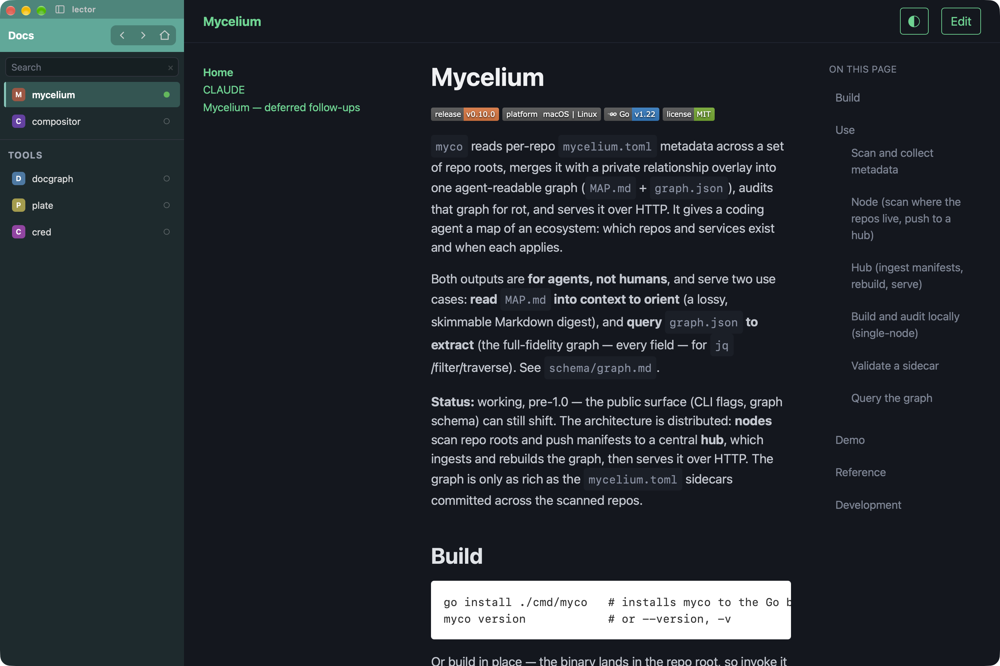

# lector

[](https://github.com/lockyc/lector/releases/latest)


[](LICENSE)

> **Dormant.** lector still works and keeps taking shared-core updates and releases, but it isn't under active development.

Read the Markdown in your local repos as rendered sites while you edit them. Each repo opens as a
themed site in a sidebar of tabs, rendered live from its working tree: saving a `.md` file
updates the page immediately — no build step, no deploy, nothing published.



## Install

**Download:** grab `lector-<version>-macos.zip` from the
[latest release](https://github.com/lockyc/lector/releases/latest), unzip, and move `lector.app`
to `/Applications`. Releases are signed and notarized.

**Or build from source** into `~/.lector` (needs Rust and the Xcode Command Line Tools); this also
seeds your config, and re-running it rebuilds from the latest source:

```sh
curl -fsSL https://raw.githubusercontent.com/lockyc/lector/main/install.sh | bash
```

lector updates itself: on launch, every 6 hours, and from **lector ▸ Check for Updates…**, an
*Update available* bar offers **Update & Relaunch**. Nothing installs without your approval, and
each update's signature is checked first.

## Features

- **One config file** declares windows, each with loose tabs and named groups of tabs; each tab
  points at a local doc repo. Edits hot-reload on save, and a window added, removed or retitled
  opens or closes live.
- **Roots find repos for you.** Point a `[[window.root]]` at a projects folder and every git repo
  under it becomes a tab, shown as a collapsible folder tree with a `⟳` rescan button.
- **Tabs load on select**, rendered by [compositor](https://github.com/lockyc/compositor); the
  sidebar dot shows which are loaded, and **⌘W** unloads the active one.
- **Sidebar search** (**⌘⇧F**) narrows the list by tab title, folder path or group name.
- **Collapse the sidebar** (**⌃⌘S**) to a thin strip; rest the pointer on the window's left edge
  to slide it back in.
- **Pop out a tab** (**⌘⇧O**) into its own window; closing that window returns it.
- **Windows** — **Window ▸ New Window…** adds one, right-clicking a window's name banner edits or
  deletes it, and with no window open lector lists them all. With no config it offers
  **Create a starter config**.
- **Navigation** — mouse side buttons and the ◀ ▶ ⌂ buttons, a page-load bar, **⌘⇧[** / **⌘⇧]**
  for the previous / next tab and **⌘1–⌘9** to jump to one.

## Configuration

`~/.config/lector/config.toml` (override with `LECTOR_CONFIG`). A fuller example is
[`examples/config.toml`](examples/config.toml).

```toml
density = "compact"

[[window]]
title  = "Docs"
colour = "#4a9"

  [[window.tab]]
  title        = "handbook"
  dir          = "~/Developer/handbook"
  load_on_open = true

  [[window.group]]
  name = "Specs"

    [[window.group.tab]]
    title = "api"
    dir   = "~/Developer/api/docs"

  [[window.root]]
  dir   = "~/Developer"
  depth = 4
```

**Global**

| Key | Default | What it does |
|---|---|---|
| `dark_mode` | `false` | Force dark window appearance; `false` follows the system. Hot-reloads. |
| `format_on_save` | `false` | Reformat the config in house style on each clean hot-reload (same as `lector fmt`). |
| `density` | `comfortable` | Chrome sizing: `comfortable` or `compact`. |
| `sidebar_drag` | `true` | Whether the sidebar chrome is a window-move drag handle. |
| `auto_update` | `true` | Check for a new release automatically; **Check for Updates…** works either way. |
| `tab_digit_keys` | `jump` | What ⌘1/⌘2 do: `jump` — ⌘1–⌘9 jump to a position; `cycle` — ⌘1 next, ⌘2 previous, jumps shift to ⌘3–⌘9. Hot-reloads. |

**`[[window]]`**

| Key | Default | What it does |
|---|---|---|
| `title` | *required* | Window title; unique across windows. |
| `width` / `height` | `1500` / `1000` | First-run size in logical pixels; after that lector remembers each window's size and position. |
| `open_on_start` | `true` | `false` keeps the window closed at launch; it stays listed in the **Window** menu. |
| `open_on_launch` | `false` | `false` opens the first `load_on_open` tab, else a blank screen; `true` opens the first tab even if it isn't loaded. |
| `colour` | none | `#rgb` / `#rrggbb` accent for the window's name banner and tint. |

**`[[window.tab]]` / `[[window.group.tab]]`**

| Key | Default | What it does |
|---|---|---|
| `title` | *required* | Display label. |
| `dir` | *required* | The doc repo to render (`~` expanded). A missing dir is a warning, not an error. |
| `load_on_open` | `false` | Load this tab at launch instead of on first select. |

**`[[window.group]]`**

| Key | Default | What it does |
|---|---|---|
| `name` | *required* | Section header; unique within its window, including against root names. |

**`[[window.root]]`**

| Key | Default | What it does |
|---|---|---|
| `dir` | *required* | Directory scanned for git repos, each becoming a lazy doc tab. |
| `name` | basename of `dir` | The root's folder label in the sidebar. |
| `depth` | `6` | How many levels deep to scan (≥ 1). |

The app binary, `/Applications/lector.app/Contents/MacOS/lector`, doubles as a config tool:
`lector validate [path]` prints the resolved windows and tabs plus any warnings, and
`lector fmt [--check] [path]` rewrites a config in house style. Both default to the config path
above.

## Related

lector's siblings share its sidebar, config and app shell:
[warden](https://github.com/lockyc/warden) — terminals,
[curator](https://github.com/lockyc/curator) — browser tabs,
[flotilla](https://github.com/lockyc/flotilla) — document workspaces.

## Development

Needs Rust and the Tauri CLI (`cargo install tauri-cli --version ^2`).

```sh
git clone https://github.com/lockyc/lector && cd lector
just run      # launch against examples/config.toml (never touches your real config)
just test     # cargo test --workspace
just gate     # the full pre-merge gate
```

lector builds on four pinned shared crates — [compositor](https://github.com/lockyc/compositor),
[chrome-core](https://github.com/lockyc/chrome-core), [config-core](https://github.com/lockyc/config-core)
and [shell-core](https://github.com/lockyc/shell-core). Working against a local checkout of one,
the hooks and the release process: [CLAUDE.md](CLAUDE.md).

## License

MIT — see [LICENSE](LICENSE).
